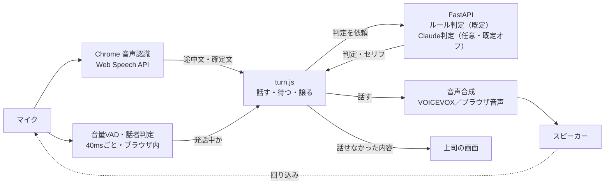
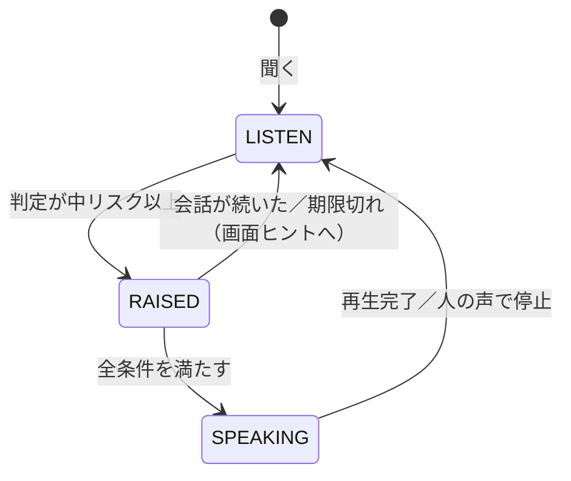

# ミナト：1on1 見守りAI（MVP）

1on1面談の最中にAIが同席し、上司の言葉が部下に「否定」と受け取られそうな瞬間だけ、上司の意図を部下に伝わりやすい形で橋渡しするMVPです。

このリポジトリは、**音声対話まわりの技術相談**のために公開しています。動くコードとテスト、いまの実装状況、まだ測れていないことをまとめました。


## 課題の捉え方

上司が良かれと思って行ったフィードバックが、部下には「否定された」と受け取られ、報告や相談が減ることがあります。これを個人の問題ではなく、**解釈のすれ違い**という構造的な課題と考えています。

ミナトは、上司の発言が部下にネガティブに解釈されそうなときだけ、部下に向けて短く（呼びかけ込み40字以内）話します。上司への言い換えの提案は、声ではなく画面に出します。

## 相談したいこと

特に難しいのは、「何を話すか」より**「いつ話すか」**の設計です。

1. AIの声を、できるだけ自然で人間らしくする方法
2. AIが会話に介入する最適なタイミングの判定方法
3. リアルタイム会話で、発話終了と割り込み可能なタイミングをどう検知するか
4. このような仕組みを実現する場合の、推奨アーキテクチャと利用技術

特に気にしているのは、**音声の認識速度と、区切り（発話終了）の検知ができているか**です。

## 現状

| 項目 | 試したこと | 確認できたこと | 未確認 |
|---|---|---|---|
| 1. 声の自然さ | 40字以内の短文、出だしの事前合成、文単位の合成、音量を下げてから停止 | 代役の音源で再生・音量低下・停止 | 本物のVOICEVOXの音質。標準はブラウザ音声 |
| 2. 介入タイミング | 下の6条件、句末ごとの待ち時間、回数上限、画面への退避 | 会話シナリオ 53/53（合成データ） | 実際の面談で自然に感じるか |
| 3. 発話終了・割り込み | 音量VAD、句末の分類、認識の確定を併用。人の声で音量低下から停止 | シナリオ上の動作 | **実マイクでの認識速度と区切りの精度**、スピーカーの回り込み |
| 4. 構成 | Chrome ＋ FastAPI のMVP、Zoom RTMS受信の実装 | デモ会話、Zoomの模擬データ | RTMSの実接続。本番構成は調査のみ |

**音声認識の速度と区切り検知は、実マイクでの実測値がまだありません。** 実測するための仕組みは入っています（[実測のしかた](#実測のしかた)）。

## 構成



音声認識は Chrome の Web Speech API で、音声が外部サーバーへ送られます。確定のタイミングはこちらで制御できません。判定とセリフ作りはこのPC内で動き、Claudeによる判定は設定でオンにしたときだけ使います。

### 「今、割って入ってよいか」の判断（`static/turn.js`）

次に誰が話すかではなく、**今、割って入ってよいか**を判断します。話さないことを既定にして、条件がそろった瞬間だけ話します。画面にも音声にも触らない純粋なロジックで、時刻を引数で受け取るため、会話シナリオをそのまま再生してテストできます。



話し出すのは、次のすべてを満たしたときだけです。

1. 上司の確定発言で、判定が中リスク以上
2. その発言が最新で、話者に確信がある
3. 確定後に、誰かが話し続けていない（累計350ms未満）
4. 句末に応じた無音が続いた
5. 手を挙げてから800ms以上たった
6. 回数の上限に達していない（既定は90秒以上あけ、30分で5回まで）

| 句末 | 必要な無音 | 例 |
|---|---|---|
| 問いかけ | 500ms | 「〜しなかったの」 |
| 言い切り | 700ms | 「〜じゃん」 |
| 判別不能 | 1000ms | |
| 言いさし | 1500ms | 「〜だけど」「〜ので」 |

数値はすべて仮置きで、実際の面談では未検証です。しきい値は `static/turn.js` の冒頭にまとまっています。

### 話し出しまでの時間（シミュレーション）

実際の `turn.js` に合成イベントを流した結果です。**実測ではありません**。発話終了を0秒として、話し出しを決めるまでの時間です（音声合成の時間は含みません。判定は確定から0.05秒と仮定）。

| 確定文までの時間（仮定） | 先行判定が当たる | 先行判定が外れる | 「〜だけど」で終わる高リスク発言 |
|---|---|---|---|
| 0.2秒 | 1.06秒 | 1.06秒 | 1.50秒 |
| 0.5秒 | 1.10秒 | 1.38秒 | 1.50秒 |
| 1.0秒 | 1.10秒 | 1.86秒 | 1.50秒 |
| 1.5秒 | 1.55秒 | 2.38秒 | 1.55秒 |
| 2.0秒 | 2.05秒 | 2.86秒 | 2.05秒 |

右端の列は先行判定が当たる場合の値です。「先行判定」は、無音が250ms続いた時点で途中文を先に判定しておく仕組みです。話し出しの速さは、**音声認識の確定が返る時間**に大きく左右されます。

## 実測のしかた

アプリには、実マイクで認識の速さと区切りを測る仕組みがあります。

- **面談中の自動計測**：発話ごとに「話し始め→最初の途中文」「話し終わり→確定文」「確定文→判定の完了」「話し終わり→ミナトが話し出す」と、発話の途中で確定した件数を記録します。ふりかえり画面に、中央値・90%点・件数が出ます。
- **読み上げ計測テスト**：スタート画面の「音声の計測テスト」から入ります。決まった10文を読み上げ、認識の速さ、1文が複数に割れていないか、確定のあとに声が続いていないか、読んだ文との一致率を測ります。「だけど、」のあとなどで約1秒止める文が2つあり、区切り検知の精度を見る中心の指標です。

保存されるのは時間・件数・一致率だけで、発言の本文は保存されません（`logs/` に保存。サーバー側でも許可した項目以外は捨てます）。測定中も、文字起こしのため音声はChromeから外部へ送られます。

計測結果は、このリポジトリのIssueに貼っていただけると、そのまま相談の材料にできます。

## 動かし方

Python 3.10 以上と Chrome が必要です。

```bash
python3 -m venv .venv
source .venv/bin/activate
pip install -r requirements.txt
cp config.example.json config.json
python3 -m uvicorn main:app --host 127.0.0.1 --port 8001
```

Chrome で `http://127.0.0.1:8001` を開きます。サーバーは、このPCからのアクセスだけを受け付けます。

- **Claude判定（任意）**：`.env` に `ANTHROPIC_API_KEY=...` を書き、設定画面でオンにしたときだけ使います。既定はオフで、キーが無くても動きます
- **音声エンジン（任意）**：[VOICEVOX](https://github.com/VOICEVOX/voicevox_engine) を `http://127.0.0.1:50021` で起動すると、その声を使います。無ければブラウザの声を使います
- **マイクなしで試す**：面談画面の「デモ会話を再生」と、テキスト入力で動作を確認できます

## テスト

```bash
node tools/test_turn.js        # 会話シナリオ再生（53件）
node tools/test_voiceprint.js  # 話者判定（合成音声56件）
node tools/test_metrics.js     # 音声計測の算出（28件）
python3 tools/test_judge.py    # 判定・セリフ・ログ・計測の保存
```

いずれも合成データによるテストで、実面談での効果や精度を示すものではありません。

## ファイル構成

| ファイル | 役割 |
|---|---|
| `static/turn.js` | 話す／待つ／譲るの判断。画面や音声に依存しない |
| `static/audio.js` | マイクの音量、文単位の音声合成、事前合成、音量制御、フェード停止 |
| `static/voiceprint.js` | 声の高さ・声色による上司／部下の判定、音量VAD |
| `static/metrics.js` | 認識の速さと区切りの計測の算出 |
| `static/measure.js` | 読み上げ計測テストの画面 |
| `static/app.js` | 画面全体。判断結果を画面と声で実行する |
| `main.py` | 判定、部下向けセリフ、外部送信の制御、ログ、アクセス制限 |
| `zoom_bridge.py` | Zoom RTMS の話者名つき文字起こしの受信（実接続は未検証） |
| `docs/音声対話_設計.md` | 相談4点への回答案、設計の根拠、Claude判定の応答時間の実測（テスト文5つ） |
| `docs/Zoom連携_設計.md` | Zoom連携の設計 |
| `docs/セキュリティ説明資料.md` | データの流れと保存先 |

## 相談の観点

1. Chrome の音声認識のまま計測を進めるべきか、先にストリーミングSTTと学習型VADへ移るべきか
2. 発話終了の検知精度を、どのような正解データと指標で評価するのがよいか
3. 対面・1マイクで、話者判定とスピーカーの回り込み対策をどう設計するか
4. 「割って入ってよいか」の判定に、ルールと学習モデルをどう組み合わせるか

本番構成の候補は、WebRTC ＋ Pipecat、Silero VAD、Smart Turn v3、日本語ストリーミングSTT（AmiVoice などを比較）です。調査のみで、未実装です。

## 注意

- 実在の人物の声を複製しません
- 部下の性格プロファイルは8問の回答から作る簡易なもので、機械学習はしていません
- ライセンスは未設定です。共有を目的に公開しており、再利用の条件は別途決めます
