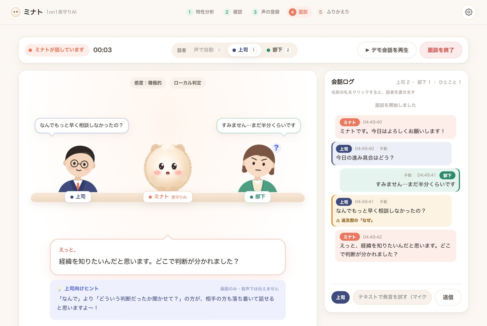
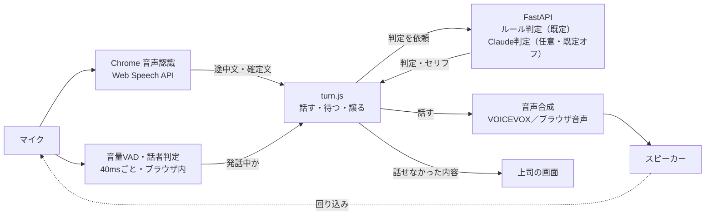
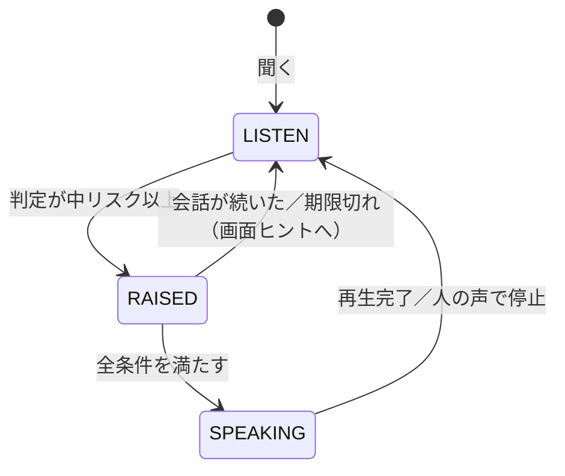

# ミナト：1on1 見守りAI（MVP）

1on1面談の最中にAIが同席し、部下が指摘を「自分の価値の否定」と受け取って自己否定に陥りそうな瞬間に、受け取り方をその場で支えるMVPです。

このリポジトリは、**音声対話まわりの技術相談**のために公開しています。動くコードとテスト、いまの実装状況、まだ測れていないことをまとめました。



## 課題の捉え方

上司が良かれと思って行ったフィードバックが、部下には「否定された」と受け取られ、報告や相談が減ることがあります。これを個人の問題ではなく、**解釈のすれ違い**という構造的な課題と考えています。

ミナトは、上司の厳しい言葉に対して部下に向けて短く（呼びかけ込み40字以内）受け取り方の声かけをし、部下が自分を責める言葉を言ったときは「起きたこと／いま浮かんでいる評価の言葉／問い」を画面に出します（設定で声でも話せます）。人格・能力の否定は受け取る練習の対象にせず、言い方の問題として扱います。上司への言い換えの提案は画面だけに出します。

## 相談したいこと

特に難しいのは、「何を話すか」より**「いつ話すか」**の設計です。

1. AIの声を、できるだけ自然で人間らしくする方法
2. AIが会話に介入する最適なタイミングの判定方法
3. リアルタイム会話で、発話終了と割り込み可能なタイミングをどう検知するか
4. このような仕組みを実現する場合の、推奨アーキテクチャと利用技術

特に気にしているのは、**音声の認識速度と、区切り（発話終了）の検知ができているか**です。

## 現状

| 項目 | 試したこと | 確認できたこと | 未確認 |
|---|---|---|---|
| 1. 声の自然さ | 40字以内の短文、出だしの事前合成、文単位の合成、音量を下げてから停止 | 代役の音源で再生・音量低下・停止 | 本物のVOICEVOXの音質。標準はブラウザ音声 |
| 2. 介入タイミング | 下の6条件、句末ごとの待ち時間、回数上限、画面への退避 | 会話シナリオ 53/53（合成データ） | 実際の面談で自然に感じるか |
| 3. 発話終了・割り込み | 音量VAD、句末の分類、認識の確定を併用。人の声で音量低下から停止 | シナリオ上の動作。実マイクで、**確定まで約2.0〜2.4秒**かかることを実測（1回・10文） | 実測は1回分のみ。区切りの精度の傾向、スピーカーの回り込み |
| 4. 構成 | Chrome ＋ FastAPI のMVP、Zoom RTMS受信の実装 | デモ会話、Zoomの模擬データ | RTMSの実接続。本番構成は調査のみ |

**音声認識の速度と区切り検知は、実マイクで1回だけ実測しました**（[実測結果](#実測結果)）。話し出しの遅れの主因は、Chromeの確定が返るまでの約2.2秒でした。件数が少なく、傾向の確認にとどまります。

## 2026-11-21 の更新

対面の1on1で、**部下が自己否定に陥らないよう、その場で自分を客観視できるよう支える**ことに集中しました（Google のコードレビューの手引きの受け手側の考え方を参考にした仮説で、効果は未検証です）。

- **判定の強化**：「使えないな」「向いてないよ」「社会人としてありえない」など人格・能力の否定を新しい種類として追加。実際に出そうな厳しい言葉30文の見逃しを17文→0文に、介入不要な22文の誤検知は0文のまま（4タイプすべて。`tools/test_judge.py` に回帰テストとして固定）
- **傾向診断**：部下本人が24問に答え、4つの傾向（自分を責める／根拠・納得を求める／口調や空気への敏感さ／自分で決めたい）を測る。画面には近いタイプ（参考）だけを出し、点数は判定の中だけで使う
- **上司の入力はすべて任意**：「面談の状況」（進捗・指摘とフォロー・目標・雑談）と「今日伝えたいこと」は、書いておくと判定と言い直しに使う
- **声のオン／オフ**：面談の前と面談中（キー V）に切り替えられる。オフでも吹き出しで伝える
- **部下の自己否定への視点**：部下が「私のせいです」などと言った時、声では割り込まず、画面に「起きたことと、自分の評価は分けて見てみませんか？」と出す
- **声の登録なしの話者判定**、**マイクを1本だけ開く**（会議アプリのマイクと取り合わない）、**ミナト用PC（2台目）で会議に参加**する仕組みも入っています

いずれも合成データ・模擬の会話による確認で、実際の面談での効果は未検証です。

## 構成



音声認識は Chrome の Web Speech API で、音声が外部サーバーへ送られます。確定のタイミングはこちらで制御できません。判定とセリフ作りはこのPC内で動き、Claudeによる判定は設定でオンにしたときだけ使います。

### 「今、割って入ってよいか」の判断（`static/turn.js`）

次に誰が話すかではなく、**今、割って入ってよいか**を判断します。話さないことを既定にして、条件がそろった瞬間だけ話します。画面にも音声にも触らない純粋なロジックで、時刻を引数で受け取るため、会話シナリオをそのまま再生してテストできます。



話し出すのは、次のすべてを満たしたときだけです。

1. 上司の確定発言で、判定が中リスク以上
2. その発言が最新で、話者に確信がある
3. 確定後に、誰かが話し続けていない（累計350ms未満）
4. 句末に応じた無音が続いた
5. 手を挙げてから800ms以上たった
6. 回数の上限に達していない（既定は90秒以上あけ、30分で5回まで）

| 句末 | 必要な無音 | 例 |
|---|---|---|
| 問いかけ | 500ms | 「〜しなかったの」 |
| 言い切り | 700ms | 「〜じゃん」 |
| 判別不能 | 1000ms | |
| 言いさし | 1500ms | 「〜だけど」「〜ので」 |

数値はすべて仮置きで、実際の面談では未検証です。しきい値は `static/turn.js` の冒頭にまとまっています。

### 話し出しまでの時間（シミュレーション）

実際の `turn.js` に合成イベントを流した結果です。**実測ではありません**。発話終了を0秒として、話し出しを決めるまでの時間です（音声合成の時間は含みません。判定は確定から0.05秒と仮定）。

| 確定文までの時間（仮定） | 先行判定が当たる | 先行判定が外れる | 「〜だけど」で終わる高リスク発言 |
|---|---|---|---|
| 0.2秒 | 1.06秒 | 1.06秒 | 1.50秒 |
| 0.5秒 | 1.10秒 | 1.38秒 | 1.50秒 |
| 1.0秒 | 1.10秒 | 1.86秒 | 1.50秒 |
| 1.5秒 | 1.55秒 | 2.38秒 | 1.55秒 |
| 2.0秒 | 2.05秒 | 2.86秒 | 2.05秒 |
| **2.2秒（実測の中央値は2.2秒）** | 2.25秒 | 3.06秒 | 2.25秒 |
| 2.4秒（実測の最大は2.4秒） | 2.45秒 | 3.26秒 | 2.45秒 |

右端の列は先行判定が当たる場合の値です。実測の確定は約2.0〜2.4秒なので、表の下側の行が実際に近い条件です。確定を待つ設計のため、先行判定が当たっても、話し出しは確定より早くなりません。Claude判定（Haiku 5.5、5文の実測の中央値1.84秒）をオンにすると、さらに判定の時間が加わり、確定が2.2秒の場合は4.0秒（先行判定が当たる）〜4.9秒になります（実測値を組み合わせた計算）。「先行判定」は、無音が250ms続いた時点で途中文を先に判定しておく仕組みです。話し出しの速さは、**音声認識の確定が返る時間**に大きく左右されます。

## 実測のしかた

アプリには、実マイクで認識の速さと区切りを測る仕組みがあります。

- **面談中の自動計測**：発話ごとに「話し始め→最初の途中文」「話し終わり→確定文」「確定文→判定の完了」「話し終わり→ミナトが話し出す」と、発話の途中で確定した件数を記録します。ふりかえり画面に、中央値・90%点・件数が出ます。
- **読み上げ計測テスト**：スタート画面の「音声の計測テスト」から入ります。決まった10文を読み上げ、認識の速さ、1文が複数に割れていないか、確定のあとに声が続いていないか、読んだ文との一致率を測ります。「だけど、」のあとなどで約1秒止める文が2つあり、区切り検知の精度を見る中心の指標です。

保存されるのは時間・件数・一致率だけで、発言の本文は保存されません（`logs/` に保存。サーバー側でも許可した項目以外は捨てます）。測定中も、文字起こしのため音声はChromeから外部へ送られます。

計測結果は、このリポジトリのIssueに貼っていただけると、そのまま相談の材料にできます。

## 実測結果

2026-11-19に、読み上げ計測テストを**1人・1回・10文**で実行した結果です。Chrome、静かな場所、面談で使うマイクで測りました。1回の結果で、マイクや声、ネットワークで変わります。傾向の確認にとどまります。

| # | 種類 | 話し始め → 最初の途中文 | 話し終わり → 確定 | 確定の回数 | 一致率 | メモ |
|---|---|---|---|---|---|---|
| 1 | 短文 | 591ms | 2031ms | 1 | 100% | |
| 2 | 問いかけ | 4940ms | 2033ms | 1 | 53% | 途中に3.4秒の無音があった。声の検知が声以外に反応した可能性 |
| 3 | 言いさし（間1.4秒） | 460ms | 2368ms | 1 | 95% | 間では割れなかった |
| 4 | 長文 | 402ms | 2402ms | 1 | 96% | |
| 5 | 言い淀み（間2.0秒） | 2797ms | **−1590ms** | 1 | 42% | **間の途中で確定し、続きが認識されなかった** |
| 6 | 相づち | 571ms | 2193ms | 1 | 100% | |
| 7 | 早口 | 627ms | 2333ms | 1 | 100% | |
| 8 | 曜日入り | 630ms | 2265ms | 1 | 93% | |
| 9 | 小声 | 1415ms | 2190ms | 1 | 76% | |
| 10 | 問いかけ | 623ms | 2253ms | 1 | 100% | |

| 集計 | 値 |
|---|---|
| 話し終わり → 確定文 | 中央値 2223ms、90%点 2368ms、最大 2402ms |
| 話し始め → 最初の途中文 | 中央値 625ms、90%点 2797ms |
| 間をあけた2文での割れ | 1/2文（間2.0秒の文で発生） |
| 読んだ文との一致率（平均） | 86%（#2と#5を除くと95%。漢字・かなの表記ゆれを含む） |

分かったことは次のとおりです。

- **確定が遅い（事実）**：10文中9文で、話し終わりから確定まで2.0〜2.4秒かかりました。文の長さによらず、ほぼ一定でした
- **確定は、約2秒の無音を待って返っている可能性が高い（推測）**：長さによらず一定だったことと、間が約2秒の文だけ間の途中で確定したことからの推測です。Chromeの仕様は確認していません
- **間が長いと続きを取りこぼす（事実）**：間1.4秒の文では割れず、間2.0秒の文では間の途中で確定し、続きが認識されませんでした（一致率42%）
- **途中文は速い（事実）**：7文は、話し始めから0.4〜0.6秒で最初の途中文が出ました。外れた3文（#2・#5・#9）は、無音の混入や小声の影響と考えられますが、原因は特定していません
- **話し出しは確定が下限（計算）**：現在の設計は確定を待ってから話すため、ローカル判定でも話し出しは話し終わりの約2.3秒後以降です（先行判定が当たる場合）。人の会話の間より、かなり長い値です
- **小声は精度が落ちた（事実）**：一致率76%でした

この1回では、声の検知（音量しきい値）が「話し終わり」の位置にどれだけ影響しているかは分かっていません。

## 動かし方

Python 3.10 以上と Chrome が必要です。

```bash
python3 -m venv .venv
source .venv/bin/activate
pip install -r requirements.txt
cp config.example.json config.json
python3 -m uvicorn main:app --host 127.0.0.1 --port 8001
```

Chrome で `http://127.0.0.1:8001` を開きます。サーバーは、このPCからのアクセスだけを受け付けます。

### GitHub Codespaces で動かす（インストール不要）

リポジトリのページで **Code → Codespaces → Create codespace on main** を押します。準備と起動は自動です。右下に転送ポート8001が出たら、**Chromeで開いて**ください（マイクの許可を求められます）。

- 最初に「このフォルダー内のファイルの作成者を信頼しますか」と出たら、「フォルダーを信頼して続行」を押してください。そのあとサーバーが自動で起動します
- 開けない（401や404になる）場合は、ターミナルで `bash .devcontainer/start.sh` を実行してから、ポート8001を開き直してください
- ポート8001は、既定で**あなただけが開ける（Private）**設定のままにしてください。公開に変えると、他の人もアプリにアクセスできます
- アクセス制限を、Codespacesのホスト名（`.app.github.dev`）に限って緩めています（`.devcontainer/devcontainer.json` の `ALLOWED_HOST_SUFFIXES`）。手元で動かす場合は、従来どおりこのPCからのアクセスだけです
- 使い終わったCodespaceは、削除または停止してください（無料枠を使います）
- 音声認識はChromeのWeb Speech APIで、音声は外部へ送られます

- **Claude判定（任意）**：`.env` に `ANTHROPIC_API_KEY=...` を書き、設定画面でオンにしたときだけ使います。既定はオフで、キーが無くても動きます
- **音声エンジン（任意）**：[VOICEVOX](https://github.com/VOICEVOX/voicevox_engine) を `http://127.0.0.1:50021` で起動すると、その声を使います。無ければブラウザの声を使います
- **マイクなしで試す**：面談画面の「デモ会話を再生」と、テキスト入力で動作を確認できます

## Render（無料）で公開して、スマホから使う

`render.yaml` を同梱しています。サーバーごと、無料枠で公開できます。

1. [Render](https://render.com) のアカウントを作り、GitHubと連携します
2. **New → Blueprint** で、このリポジトリを選びます
3. 入力欄 `ACCESS_PASSWORD` に、**自分で決めた合言葉**を入れて、デプロイします
4. 発行された `https://….onrender.com` を開くと、**ログイン画面**が出ます。合言葉を入れて「開く」を押します（30日間は、同じ端末で入力不要です）

- 合言葉は、リポジトリには書きません。Renderの画面で入力します。公開モード（`PUBLIC_MODE=1`）では、合言葉が未設定だと全アクセスを拒否します。失敗が8回続くと、しばらく受け付けません
- 15分使わないとスリープし、次のアクセスで起動に1分ほどかかります。ログは再起動で消えます
- スマホは、**AndroidのChrome**で音声認識が使えます。iPhoneのSafariは、音声認識が動かない、または不安定です（画面の確認とテキスト入力は使えます）
- Claude判定は、APIキーを登録しなければオフのままで、費用はかかりません
- 音声認識では、音声がChromeから外部へ送られます

## テスト

```bash
node tools/test_turn.js        # 会話シナリオ再生（55件）
node tools/test_voiceprint.js  # 声を登録した話者判定（合成音声56件）
node tools/test_diarize.js     # 声を登録しない話者判定（合成音声の会話120発言）
node tools/test_metrics.js     # 音声計測の算出（28件）
python3 tools/test_judge.py    # 判定・セリフ・実際に出そうな言葉52文・傾向診断・面談の状況・ログ
python3 tools/test_access.py   # ホスト名・合言葉・ログイン画面・公開モードのアクセス制限
python3 tools/test_stage.py    # ミナト用PC（2台目）との中継と接続の守り
```

いずれも合成データによるテストで、実面談での効果や精度を示すものではありません。

## ファイル構成

| ファイル | 役割 |
|---|---|
| `static/turn.js` | 話す／待つ／譲るの判断。画面や音声に依存しない |
| `static/audio.js` | マイクの音量、文単位の音声合成、事前合成、音量制御、フェード停止 |
| `static/voiceprint.js` | 声の高さ・声色による上司／部下の判定、音量VAD |
| `static/diarize.js` | 声を登録しない話者判定（対面：声の違い＋敬語の差／オンライン：マイクか会議の音か） |
| `static/stage.html`・`stage.js` | ミナト用PC（2台目）のステージ画面 |
| `static/stage_link.js` | 面談画面からミナト用PCへの指示と報告の受け取り |
| `static/metrics.js` | 認識の速さと区切りの計測の算出 |
| `static/measure.js` | 読み上げ計測テストの画面 |
| `static/app.js` | 画面全体。判断結果を画面と声で実行する |
| `main.py` | 判定、部下向けセリフ、外部送信の制御、ログ、アクセス制限 |
| `zoom_bridge.py` | Zoom RTMS の話者名つき文字起こしの受信（実接続は未検証） |
| `stage_bridge.py` | ミナト用PCとの中継（同じWi-Fi内・合言葉つき。`tools/start_lan.sh` で起動した時だけ） |
| `docs/ミナト用PC_設定手順.md` | 2台目のPCを「ミナト」として会議に参加させる手順 |
| `docs/音声対話_設計.md` | 相談4点への回答案、設計の根拠、Claude判定の応答時間の実測（テスト文5つ） |
| `docs/Zoom連携_設計.md` | Zoom連携の設計 |
| `docs/セキュリティ説明資料.md` | データの流れと保存先 |

## 相談の観点

1. 実測では、Chrome の確定が約2.2秒かかりました。このまま計測を進めるべきか、先にストリーミングSTTと学習型VADへ移るべきか
   - 確定を待たずに発話終了を判断する場合、何を根拠にするのがよいか（途中文の安定、VAD、発話終了モデルなど）
2. 発話終了の検知精度を、どのような正解データと指標で評価するのがよいか
3. 対面・1マイクで、話者判定とスピーカーの回り込み対策をどう設計するか
4. 「割って入ってよいか」の判定に、ルールと学習モデルをどう組み合わせるか

本番構成の候補は、WebRTC ＋ Pipecat、Silero VAD、Smart Turn v3、日本語ストリーミングSTT（AmiVoice などを比較）です。調査のみで、未実装です。

## 注意

- 実在の人物の声を複製しません
- 部下の性格プロファイルは8問の回答から作る簡易なもので、機械学習はしていません
- ライセンスは未設定です。共有を目的に公開しており、再利用の条件は別途決めます
